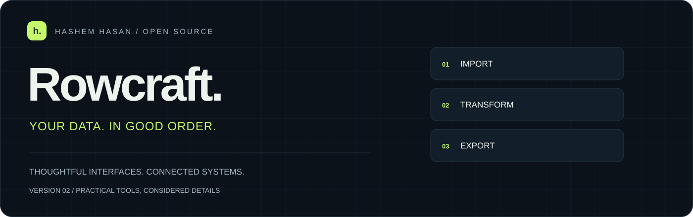
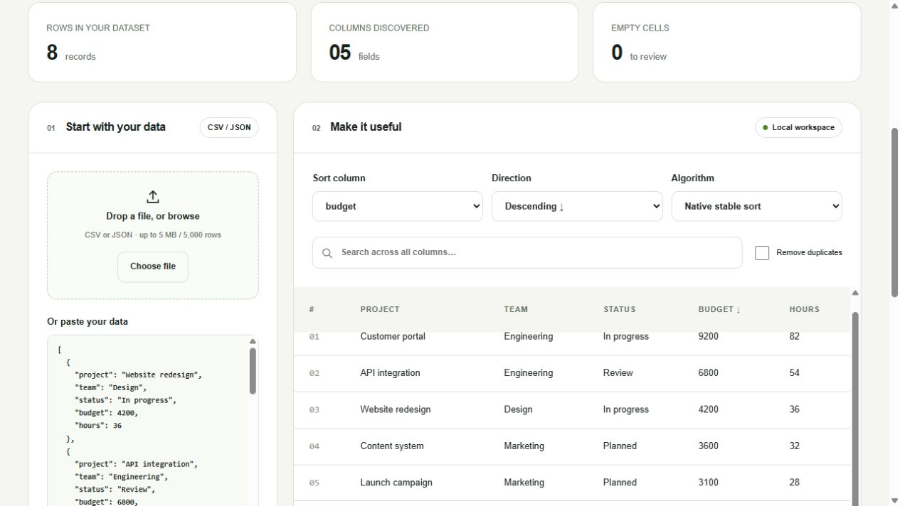

<p align="center"><picture><source media="(prefers-color-scheme: light)" srcset="./docs/hero-light.svg"></picture></p>

<p align="center"><strong>A local-first CSV and JSON workbench for turning messy exports into useful datasets.</strong></p>
<p align="center"><a href="#what-you-can-do">Explore features</a> · <a href="#run-locally">Run locally</a> · <a href="#how-it-fits-together">Architecture</a> · <a href="https://hashem-hasan.github.io/">About the builder</a></p>

<p align="center">  </p>

<br>

## The experience



## What you can do

<table><tr>
<td width="50%" valign="top"><h3>Bring your own data</h3><p>Paste JSON, upload CSV or JSON, or drop a file. Quoted commas, multiline cells and Unicode are supported.</p></td>
<td width="50%" valign="top"><h3>Work with any columns</h3><p>Column discovery, natural text and numeric sorting, ascending/descending order, text search and optional deduplication.</p></td>
</tr></table>

<table><tr>
<td width="50%" valign="top"><h3>Keep the learning mode</h3><p>Stable selection sort with comparison counts, bounded to 500 rows; native stable sorting handles larger datasets.</p></td>
<td width="50%" valign="top"><h3>Take the result with you</h3><p>CSV and JSON exports include every matching row, not just the first 250 shown in the preview.</p></td>
</tr></table>

<table><tr>
<td width="50%" valign="top"><h3>Keep data local</h3><p>No external APIs, network uploads, accounts or persistent storage. Malformed input leaves the previous dataset intact.</p></td>
</tr></table>

## Run locally

Use **Node.js 24** and npm. Install from the committed lockfile:

```bash
git clone https://github.com/Hashem-Hasan/Data-Sorter.git
cd Data-Sorter
npm ci
npm run dev
```

Open [localhost:3000](http://localhost:3000). For a production build:

```bash
npm run build
npm start
```

## How it fits together

```text
app/page.js               Interactive workspace
lib/data.mjs              Parsing, stable sorting, deduplication and export
tests/data.test.mjs        Data integrity and boundary tests
```

## Quality checks

```bash
npm test
npm run lint
npm run build
```

Tests cover quoted CSV, Unicode, invalid row shapes, numeric ordering, null handling, stable ties, comparison counts, deduplication, formula neutralization and size limits.
GitHub Actions runs the same three checks on pushes and pull requests. Screenshots document the interface; they are not a claim of automated accessibility certification.

## Scope and deployment

Input limits are 5 MB, 5,000 rows and 128 columns. CSV exports prefix potentially executable spreadsheet formula strings with an apostrophe. Nested JSON values are displayed as JSON text; this is a flat-table workbench, not a relational database.

---

**Built by [Hashem Hasan](https://github.com/Hashem-Hasan)** · [Portfolio](https://www.tarneebtech.com/) · [LinkedIn](https://www.linkedin.com/in/hashem-hasan)

<sub>Original repository names are preserved so existing links keep working. Visuals are original code-based artwork; no invented user, revenue or performance claims.</sub>
